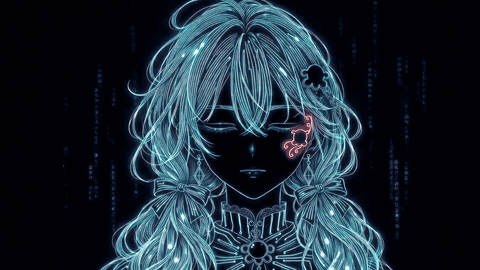
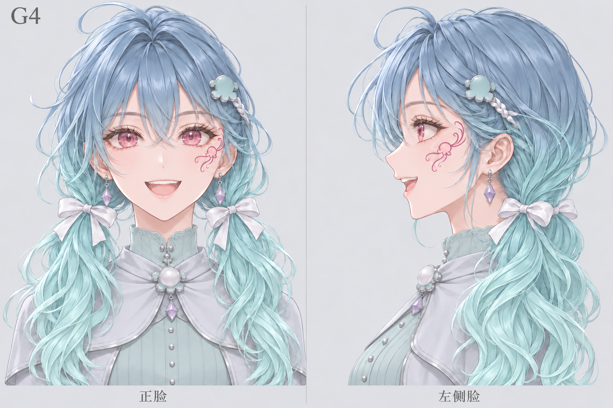
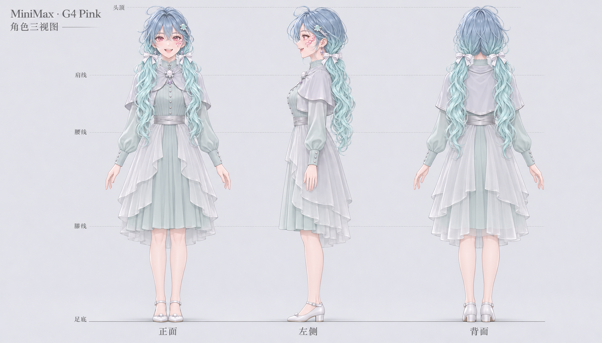
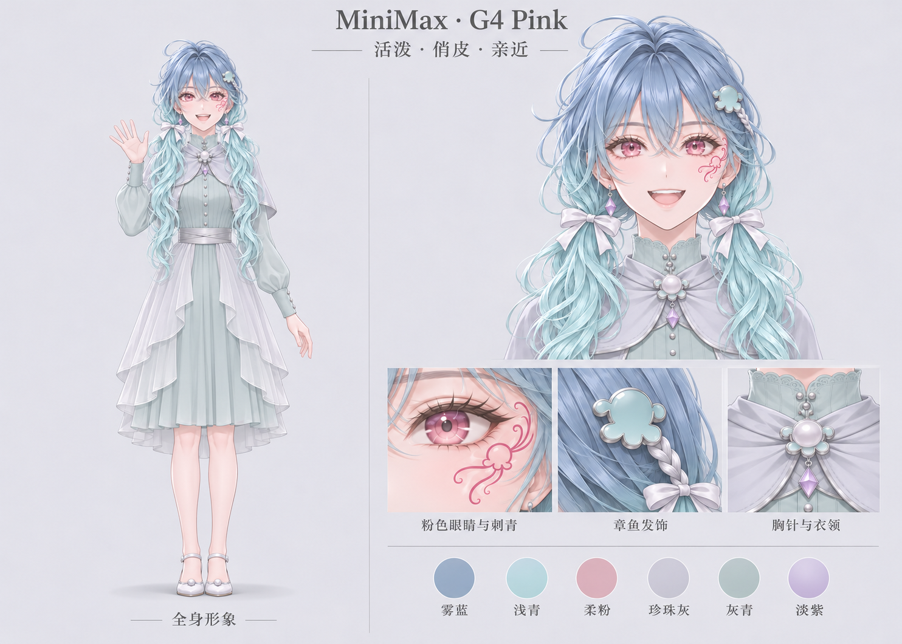
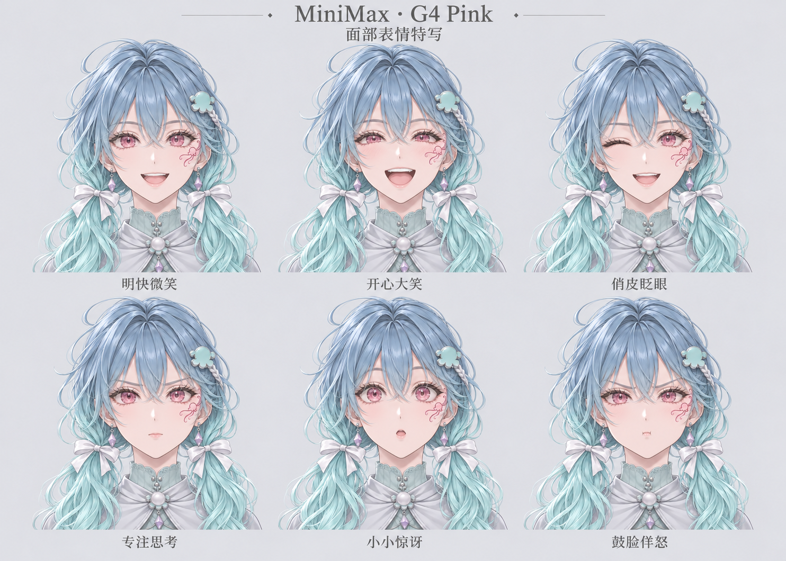
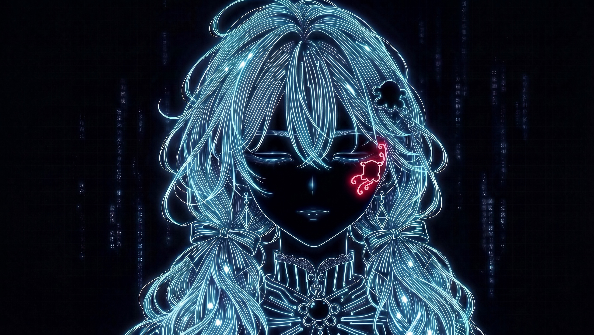
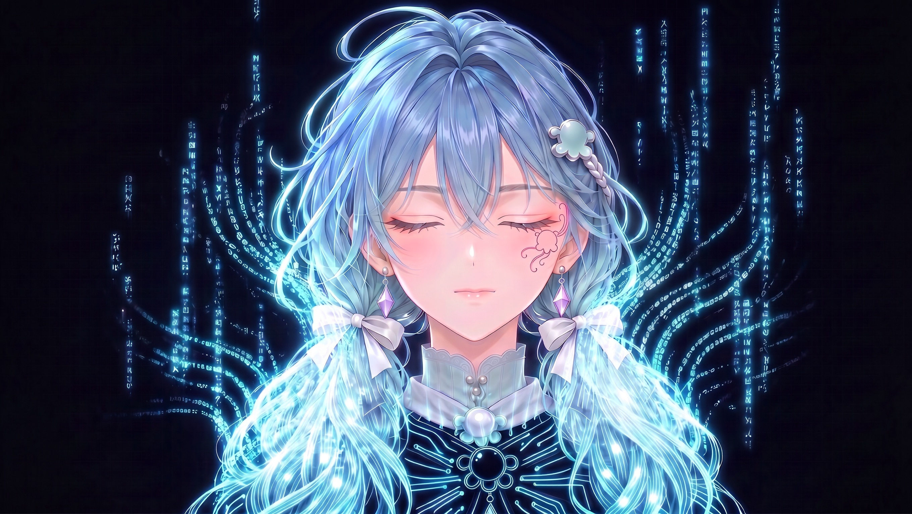
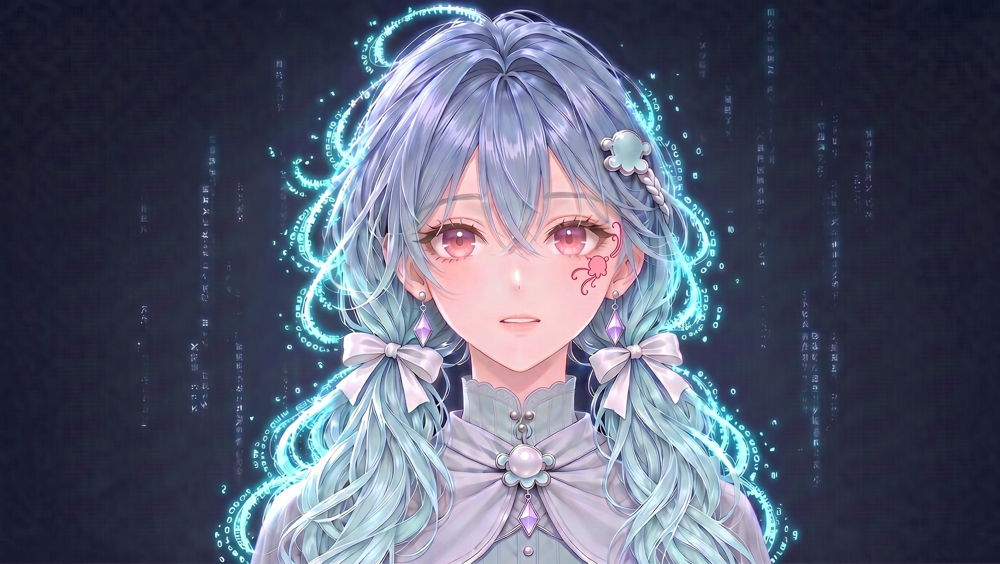
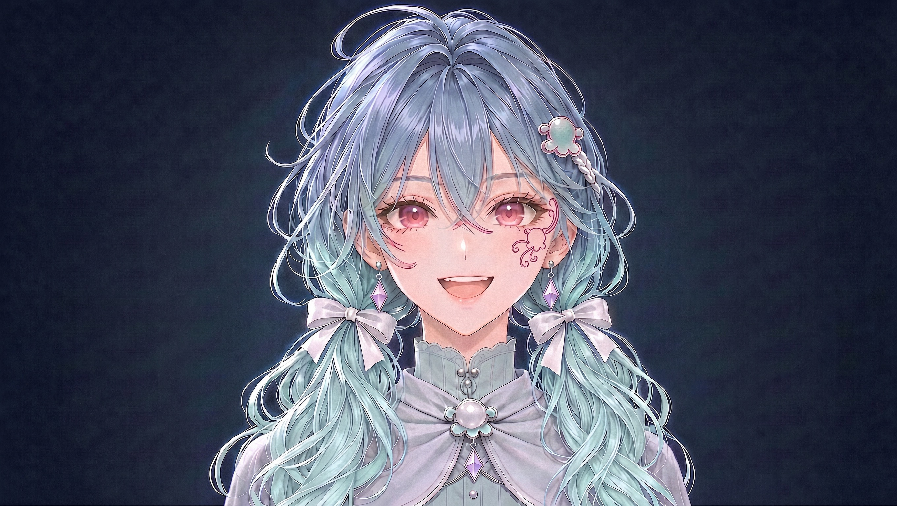

<p align="center"></p>

<h1 align="center">MCode 章鱼少女</h1>

<p align="center">以 MiniMax 章鱼为灵感的二次元角色：设定图、刺青母版、启动动画和生成提示词。</p>

> 个人非官方二创项目，不代表 MiniMax 官方立场。角色名暂未确定，目录名可能会变。

## 她是谁

一位活泼、俏皮、亲近的成年少女，像随时准备帮你把事情做完的搭档。

| 项目 | 设定 |
|---|---|
| 发型 | 雾蓝到浅青渐变的低双马尾，白色蝴蝶结；画面右侧头顶别着章鱼发夹，旁边一缕细编发 |
| 眼睛 | 柔粉色 |
| 核心标记 | 人物**左眼外侧**（画面右侧）的玫瑰粉刺青：中心是小小的 MCode 章鱼图标轮廓（圆头、两只外卷的耳鳍、三瓣圆触腕），周围是卷须花纹。左右位置固定，不镜像 |
| 服装 | 珍珠灰短披肩、灰青高领，珍珠章鱼胸针坠一颗淡紫色宝石，淡紫耳坠 |
| 配色 | 雾蓝 · 浅青 · 柔粉 · 珍珠灰 · 灰青 · 淡紫 |
| 性格 | 活泼、俏皮、亲近 |

## 目录

```text
characters/mcode-octopus-girl/
  reference-sheets/   设定图：正脸与侧脸、三视图、角色卡、六种表情（v0，刺青为旧版，见下）
  tattoo/             刺青母版：以后所有画面的刺青都以它为准
animations/boot/      启动动画（6.5 秒）、GIF 预览和四张关键帧
prompts/              关键帧和视频的生成提示词
```

## 设定图

| 正脸与侧脸 | 三视图 |
|---|---|
|  |  |
| **角色卡** | **表情** |
|  |  |

v0 设定图里的刺青还是旧版（中心是小章鱼头）。现行刺青以 [刺青母版](characters/mcode-octopus-girl/tattoo/tattoo-master.jpg) 为准，设定图之后会按它重画。

## 启动动画

[`animations/boot/boot.mp4`](animations/boot/boot.mp4)：2560×1440，约 6.5 秒，带音轨。电路线稿亮起 → 代码串沿走线注入 → 扫描光自下而上上色 → 睁眼发现你 → 笑。

| 01 电路线稿 | 02 代码唤醒 | 03 睁眼 | 04 笑 |
|---|---|---|---|
|  |  |  |  |

视频用 01 作首帧、04 作尾帧，02、03 写进提示词作为中间节拍。提示词见 [prompts/](prompts/)。

## 怎么用

欢迎二创：画图、做桌宠、做皮肤、做动画都可以，也可以商用，署名即可（见下方许可）。做出东西可以通过 [Issue](../../../issues/new?template=community-artwork.yml) 分享。

## 许可

| 内容 | 许可 |
|---|---|
| 代码、脚本 | [MIT](LICENSE) |
| 角色设定、设定图、刺青、动画、关键帧、说明文字和提示词 | [CC BY 4.0](LICENSE-ARTWORK.md)，可商用，需署名 |
| MCode / MiniMax 名称与图标 | **不在上述许可内**，属于其权利人，见 [NOTICE](NOTICE.md) |

素材由 AI 生成或 AI 辅助完成，详见 [NOTICE](NOTICE.md)。
